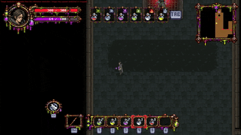

# 🧪 Potion Junkie (포션 정키)

물약에 중독된 주인공이 금단증상을 피하려고 포션 던전을 내려가며 포션을 **구하고, 마시고, 던지는** 2D 탑뷰 로그라이크입니다.

| | |
|---|---|
| 팀명 | 일일퀘스트 (4인) |
| 장르 / 플랫폼 | 2D 탑뷰 로그라이크 / Windows |
| 개발 기간 | 2026.09.23 ~ 2026.10.14 (약 3주) |
| 엔진 / 언어 | Unity 6000.3.22f1 / C# |
| 패키지 | DOTween, Input System, UI Effect |
| 링크 | [시연 영상](https://youtu.be/0gpzyluhml4) · [개발 상세 (Notion)](https://app.notion.com/p/Potion-Junkie-2D-40d961aba7008050ac44eced675f5391) |

> 팀 프로젝트의 커밋 이력을 그대로 가져온 포트폴리오용 사본입니다.

## 핵심 플레이

`적 처치 → 포션 획득 → 포션 종류 식별 → 더 강한 적`

포션 하나로 체력과 금단증상을 관리하며 싸우고, 던진 포션의 장판끼리 겹치면 조합 효과로 바뀝니다.

## 주요 기능

- **포션 조합**: 장판이 겹치면 원소 조합 데이터를 조회해 새 효과로 교체 (`IPotionEffectData`, 전략 패턴)
- **몬스터 길찾기**: 다익스트라 기반 Flow Field. 몬스터 수와 무관하게 연산량 일정, 크기별 레이어, look-ahead 경로 스무딩
- **절차적 맵 생성**: 방 순서 계획 → 출구/복도/입구 정렬 → 충돌 검증 → 프리팹 생성
- **데이터 기반 설계**: 웨이브, 포션, 밸런스 수치를 ScriptableObject로 분리해 기획자가 직접 조절
- **인게임 UI**: MVP 패턴

## 팀 구성

| 이름 | 역할 | 주요 작업 |
|---|---|---|
| 김문규 | 클라이언트 | 포션 시스템, 사운드, 몬스터 전투 로직, 인게임 UI, 데이터 SO화 |
| 이양빈 | 클라이언트 | 몬스터 전투 로직, 길찾기, 사운드, VFX |
| 강윤민 | 클라이언트 | 플레이어, 맵 생성 시스템, 인게임 UI |
| 홍준순 | 기획, 에셋 | 컨셉/세부 기획, 에셋 수집, 스테이지 디자인 |
